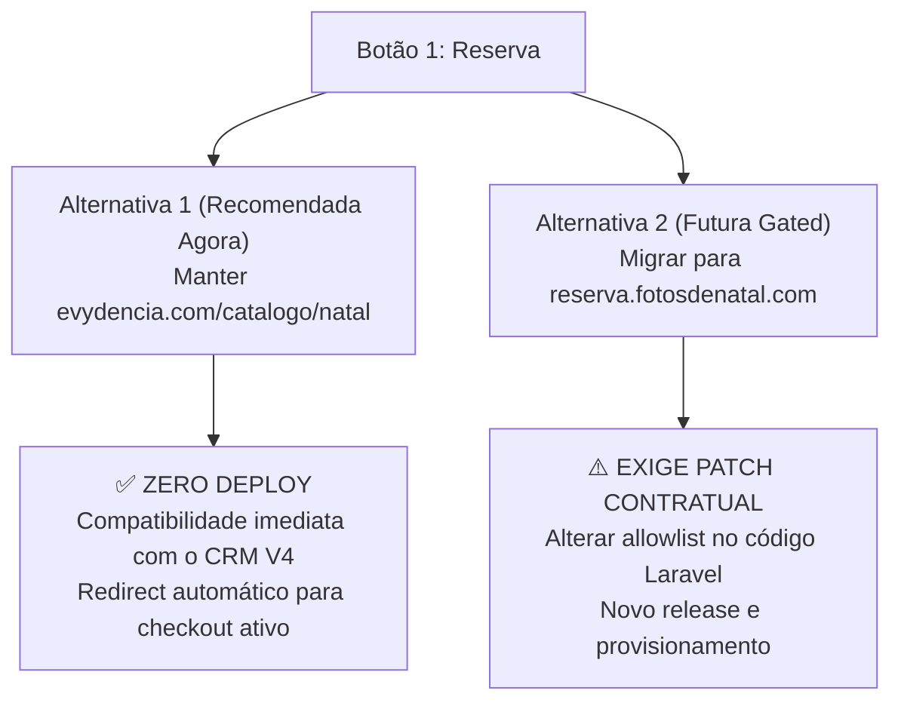

# CONTRATO-BOTOES-URL-GATE — Análise Contratual e Portão de Checkout Direto

**Data:** 26/10/2026  
**Ambiente:** Somente Leitura (`AUDIT_ONLY`)  
**Código de Referência:** `app/Services/Proposals/Natal2026ProposalManifest.php` (CRM Laravel main)  
**Status Atual no Draft V5:** `checkout_gate: "BLOCKED_BY_APPROVED_V4_URL_ALLOWLIST"`

---

## 1. O Contrato Rígido de Validação de Botões no CRM V4

A auditoria direta do código-fonte do CRM em `Natal2026ProposalManifest.php` revelou que o provisionador do fluxo de Natal impõe uma validação estrita em tempo de verificação:

```php
// Regra comprovada em Natal2026ProposalManifest::validate
$expectedButtons = [
    ['id' => 'natal2026-reservar', 'type' => 'URL', 'url' => 'https://evydencia.com/catalogo/natal'],
    ['id' => 'natal2026-horarios', 'type' => 'URL', 'url' => 'https://horarios.fotosdenatal.com/'],
    ['id' => 'natal2026-instagram', 'type' => 'URL', 'url' => 'https://instagram.com/estudioevydenciaa'],
];
```

### Regras do Validador V4:
1. **Identificadores Estáveis Obrigatórios:** Os IDs dos botões devem ser exatamente `natal2026-reservar`, `natal2026-horarios` e `natal2026-instagram`. Renomeações para formatos genéricos (como `btn_reservar` ou `btn_insta`) quebram a validação do contrato.
2. **Ordem e Tipos Fixos:** Todos os 3 botões devem ser estritamente do tipo `URL`.
3. **Allowlist Fechada de Destinos:** Apenas as 3 URLs acima são aceitas. Qualquer tentativa de salvar o fluxo apontando para `https://reserva.fotosdenatal.com/` gera exceção de validação (`natal_manifest_configuration_mismatch`) e bloqueia a prontidão comercial.

---

## 2. As Duas Alternativas para o Botão 1 (Reserva)



### Alternativa 1 (Recomendada para V5 Inicial — Sem Deploy)
- **Destino do Botão:** `https://evydencia.com/catalogo/natal`
- **ID:** `natal2026-reservar` | **Label:** `🎄 Reservar Agora`
- **Comportamento em Produção:** A URL do catálogo já está plenamente funcional e responde com HTTP 200. No tráfego real, a página de catálogo contém o link de direcionamento imediato para a agenda e o checkout.
- **Vantagem Operacional:** Não exige intervenção no código do CRM, não altera o `configuration_hash` aprovado e não gera risco de falha de provisionamento.

### Alternativa 2 (Melhoria Futura Delimitada — Exige Patch no CRM)
- **Destino Pretendido:** `https://reserva.fotosdenatal.com/`
- **Justificativa Comercial:** Reduz uma etapa de navegação do lead, levando diretamente ao carrinho/checkout.
- **Por que NÃO pode ser feita agora:** O código do CRM em produção recusa a URL por restrição de contrato. Editar apenas no painel ou via banco causaria inconsistência imediata.

---

## 3. Especificação do Menor Patch Contratual Necessário (Para Futura Execução)

Caso a direção decida formalmente adotar o checkout direto na próxima sprint de engenharia, a menor alteração delimitada no repositório `hypeneural/evydencia-crm` consiste em:

1. **Arquivo:** `app/Services/Proposals/Natal2026ProposalManifest.php`
   - Atualizar a allowlist do Botão 1 para aceitar `https://reserva.fotosdenatal.com/` (ou manter ambas como variantes aceitas).
2. **Arquivo de Teste:** `tests/Unit/Services/Proposals/Natal2026ProposalManifestTest.php`
   - Atualizar a asserção de teste unitário dos botões URL de T0.
3. **Provisionador:** Executar a geração do novo `configuration_hash` e homologação em staging.
4. **Rollback:** Preservar a compatibilidade reversa com `https://evydencia.com/catalogo/natal`.

---

## 4. Veredito de Governança

- **Para o Rascunho Editorial V5 Atual:** Mantida a **Alternativa 1** (`https://evydencia.com/catalogo/natal`), assegurando conformidade estrita com o validador automatizado [`scripts/validate_editorial.py`](file:///c:/Users/Anna%20Helena/Documents/antigravity/beautiful-hypatia/scripts/validate_editorial.py).
- **Classificação:** `GO` para aprovação editorial do catálogo V4; `GATE_LOCKED` para o checkout direto até aprovação do patch de código no CRM.
