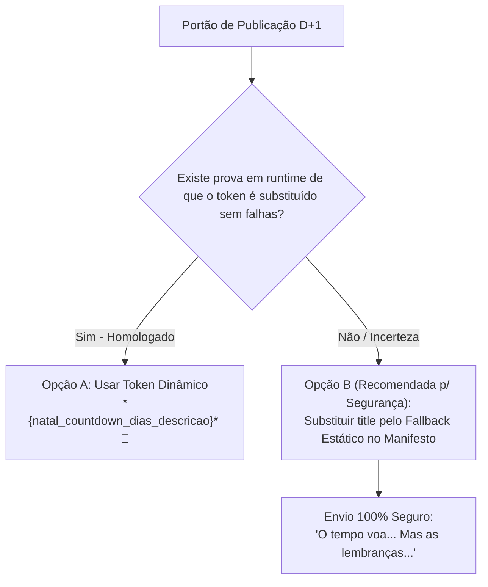

> **PORTÃO RESOLVIDO APENAS NO RASCUNHO:** A V5 canônica em `editorial/whatsapp-v5.draft.json` agora usa legenda D+1 **estática** e sem `{natal_countdown_dias_descricao}`. Este arquivo documenta o risco da hipótese dinâmica anterior, não a decisão de envio atual. O token calcula prazo até **25/12**, não até a data de encerramento dos ensaios. Para reintroduzi-lo exigir prova de renderização no worker e aprovação separada.

# COUNTDOWN-RENDER-GATE — Análise da Variável Dinâmica de D+1 e Portão de Fallback

**Data:** 26/10/2026  
**Ambiente:** Somente Leitura (`AUDIT_ONLY`)  
**Etapa Auditada:** D+1 (`role: whatsapp_d1` — Etapa ID 662 Camp. 415 / ID 681 Camp. 416)  
**Mensagem de Vídeo:** ID `1456` (415) / `1472` (416) — `natal2026-rev357-v1-d01.mp4`

---

## 1. Funcionamento Técnico no CRM Laravel

No fluxo de envio de mensagens do CRM, a substituição de variáveis é executada pela classe `MessageVariableService`:

```php
// app/Services/Messages/CampaignMessageService.php
private function parse(Message $message): Message
{
    return (new MessageVariableService())
        ->setContact($this->customer->name, $this->customer->whatsapp)
        ->parseMessage($message);
}
```

O método `parseMessage($message)` substitui tokens em três propriedades:
- `$message->title` (enviado como caption de vídeo/imagem pela Z-API)
- `$message->message` (texto do corpo)
- `$message->description` (metadado/footer)

O token `{natal_countdown_dias_descricao}` é resolvido dinamicamente pelo cálculo da diferença entre a data atual e a data-alvo de encerramento das sessões de Natal.

---

## 2. O Risco Crítico do `fallback_title`

No arquivo de planejamento editorial `editorial/whatsapp-v5.draft.json`, consta a seguinte estrutura:

```json
{
  "message_role": "video_d1",
  "type": "video",
  "title": "*{natal_countdown_dias_descricao}* 🎄\nSeus filhos crescem rápido... As lembranças deste Natal ficam pra sempre. ❤️",
  "fallback_title": "O tempo voa... Mas as lembranças deste Natal ficam pra sempre. ❤️",
  "countdown_gate": "Fallback is editorial field only; current CRM runtime does not automatically select fallback_title."
}
```

> [!CAUTION]
> **O CRM NÃO POSSUI MECANISMO DE FALLBACK AUTOMÁTICO EM RUNTIME**  
> O campo `fallback_title` é um metadado **exclusivamente documental** do arquivo JSON de planejamento.  
> Na execução real do CRM, o worker lê apenas a coluna física `messages.title`. Se por qualquer motivo o parser falhar, se a variável não estiver registrada no escopo daquele disparo ou se a contagem resultar em string vazia, o worker **não** irá chavear para o `fallback_title` — o WhatsApp entregará o token cru `*{natal_countdown_dias_descricao}*` para o cliente!

---

## 3. Matriz de Decisão do Portão de Publicação



### Opção A (Manter Variável Dinâmica)
- **Requisito Obrigatório:** Realização prévia de teste canário autenticado com recebimento real no WhatsApp receptor, comprovando que o token expande para texto humanizado (ex: *"Faltam 45 dias para o Natal"*).
- **Risco:** Dependência de cálculo de datas e ausência de fallback automático.

### Opção B (Recomendada para Publicação Executável — Máxima Segurança)
- **Ação:** Antes de gerar o manifesto executável para o CRM, substituir o campo `title` da mensagem D+1 diretamente pela cópia estática aprovada:
  > *"O tempo voa... Mas as lembranças deste Natal ficam pra sempre. ❤️"*
- **Vantagem:** Elimina 100% do risco de entrega de tokens não compilados no celular dos clientes.

---

## 4. Veredito de Governança

- **Classificação:** `PENDING_RENDER_GATE`
- **Recomendação:** A proposta editorial conserva o token no draft V5 com o portão de controle ativo. Caso a gestão autorize a aplicação sem um ciclo de testes canários de mensageria, adotar a **Opção B (Fallback Estático Literal)** no manifesto de provisionamento.
