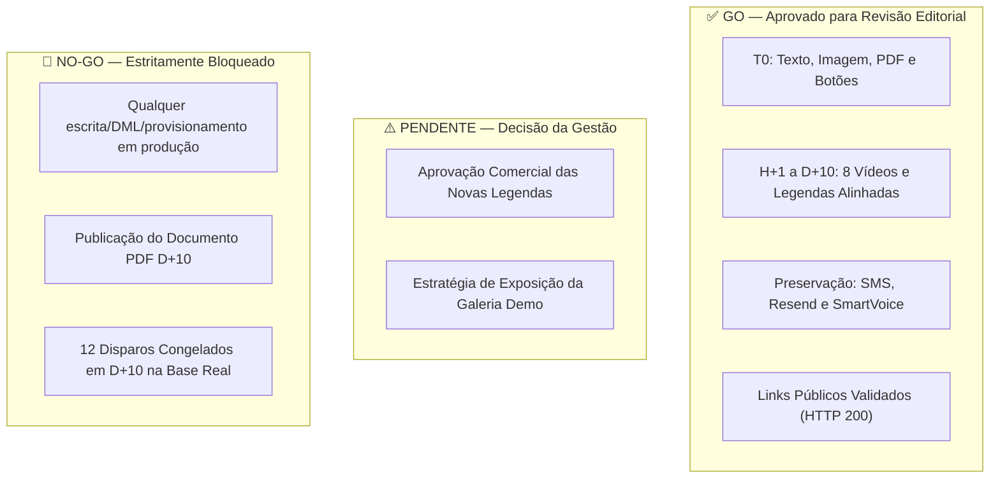

# GO-NOGO — Avaliação Executiva de Prontidão e Governança

**Data da Decisão:** 26/10/2026  
**Inventário DB:** `reports/20261026-123430/inventory.json`  
**Hash de Configuração do DB:** `f64e93402d086abdfd0c678ff173ee1891cefe50f9ed3c381db0102a0ad5c055`  
**Revisão do Manifesto:** `natal2026-content-v4-20261021`  
**Status da Reconciliação Local:** `CONSISTENT_FOR_EDITORIAL_REVIEW_ONLY` (Exit code 0)  
**Status de Mídias:** `MEDIA_MATCH` (8 de 8 vídeos validados por SHA-256 e frames)

---

## 1. Painel de Decisão por Portão de Qualidade

---

## 2. Detalhamento por Área de Governança

### 2.1 Etapa Inicial T0 (WhatsApp) — ✅ GO
- **Credibilidade desde 2011:** Inserida de forma elegante e factual (*"Desde 2011 em Tijucas, registrando histórias de família"*), sem exageros ou afirmações não comprovadas.
- **Copy Curta e Sem Poluição:** Eliminados os triple-backticks literais (`'''`) do V4.
- **Pacotes e Valores:** Entrada clara a partir de *2x R$ 98*. Sem promessas de 10 parcelas não homologadas.
- **Pergunta de Engajamento:** *"Vocês preferem semana ou fim de semana?"* (estimula resposta natural do lead).
- **Legenda da Imagem:** Configurada em `messages.title` para garantir exibição correta pela Z-API.
- **Nome do PDF:** Corrigido para `Proposta-Natal-AnoNovo-Evydencia-2026.pdf` (extensão explícita para evitar falhas mobile).
- **Botões Interativos:** IDs canônicos estáveis preservados (`natal2026-reservar`, `natal2026-horarios`, `natal2026-instagram`). Botão 1 mantido na URL canônica permitida pelo validador V4 (`https://evydencia.com/catalogo/natal`); a troca para checkout direto (`reserva.fotosdenatal.com`) está protegida pelo portão `checkout_gate: "BLOCKED_BY_APPROVED_V4_URL_ALLOWLIST"`, exigindo liberação futura do contrato.
- **Opt-out:** `_Para parar lembretes, responda PARARNATAL2026._` assegurado na abertura.

---

### 2.2 Esteira de Vídeos H+1 a D+10 — ✅ GO
- **H+1 (1 hora):** Legenda alinhada com a menina brincando na Vila de Natal com Papai e Mamãe Noel.
- **H+90 (90 min):** Enfatiza a praticidade dos dois cenários em família; eliminadas promessas infundadas de parcelamento.
- **D+1 (24 horas):** Apelo emocional e passagem do tempo com contagem regressiva dinâmica `{natal_countdown_dias_descricao}` e fallback estático estrito (*"O Natal já está chegando e o tempo voa..."*).
- **D+2 (48 horas):** Surpresa de dois cenários (Natal e Ano Novo) combinando com o bebê na árvore.
- **D+3 (72 horas):** Demonstração real de `jogos.fotosdenatal.com`. Não promete 10 jogos para todos os pacotes, respeitando a regra comercial 1/5/10.
- **D+4 (96 horas):** Figurinos temáticos e bolhas de sabão alinhados com o vídeo do vestido xadrez.
- **D+5 (120 horas):** **Ajuste Cirúrgico Concluído.** Legenda adaptada à Fada/Duende desenrolando o pergaminho mágico luminoso, sem prometer inclusão física de personagens na sessão.
- **D+10 (240 horas):** Follow-up amistoso com a personagem acenando. Eliminada escassez fabricada ("quase esgotados") e reserva prévia fictícia.

---

### 2.3 Canais SMS, Resend e SmartVoice — ✅ GO
- **9 Etapas de SMS:** Preservadas sem qualquer modificação em textos, horários de calendário ou links de contato.
- **Resend E-mail T0:** Mantido inalterado com seu template textual limpo.
- **SmartVoice:** 5 chamadas em fila de voz mantidas sem ativação de chave `enabled`.

---

### 2.4 Documento PDF D+10 — 🛑 NO-GO (BLOQUEADO)
- **Status:** `blocked_do_not_publish`.
- **Motivo Técnico:** O binário `natal2026-rev357-v1-d10-document.pdf` simula um comprovante de transferência Pix digital. Trata-se de marketing de curiosidade de alto risco, passível de denúncia por spam e bloqueio de canal da Z-API.
- **Requisito Operacional:** O bloqueio no arquivo JSON local é apenas uma proteção editorial. Para o ambiente de produção, este anexo deve ser suprimido ou substituído por canal seguro.

---

### 2.5 Tratamento dos Snapshots Congelados no DB — 🛑 NO-GO (BLOQUEADO)
- **Fato Comprovado:** A tabela `campaign_contact_stage_runs` possui **12 execuções pendentes agendadas** para as etapas D+10 (etapas 666 e 685).
- **Mecanismo do CRM:** O CRM utiliza `campaign_contact_stage_runs.stage_snapshot` e `legacy_messages` para o disparo. **Editar o cadastro na tabela `messages` não altera snapshots já congelados.**
- **Diretriz de Segurança:** Nenhum envio deve ocorrer para esses 12 agendamentos sem que uma rotina administrativa homologada cancele ou recalcule os snapshots de forma autorizada.

---

### 2.6 Aplicação e Deploy no CRM — 🛑 NO-GO (BLOQUEADO)
- **Nenhum comando `--apply`** está autorizado.
- **Nenhuma migration ou comando Artisan** (`php artisan proposals:doctor natal`) deve ser executado, pois atualiza o estado de saúde e persiste alterações no banco.
- **Modo Atual:** Estritamente **`AUDIT_ONLY`**.

---

## 3. Síntese Executiva

| Dimensão | Veredito | Próxima Ação Necessária |
| :--- | :---: | :--- |
| **Banco Real vs Manifesto V4** | **GO** | Nenhuma divergência. Base perfeitamente reconciliada. |
| **Integridade de Mídias Locais** | **GO** | 8 de 8 vídeos auditados e aprovados frame a frame. |
| **Revisão Editorial WhatsApp V5** | **GO** | Submeter os textos de T0 e D+5 à aprovação final da gestão. |
| **Disparo e Publicação em Produção** | **NO-GO** | Aguardar aprovação comercial e rotina de higienização de snapshots. |
