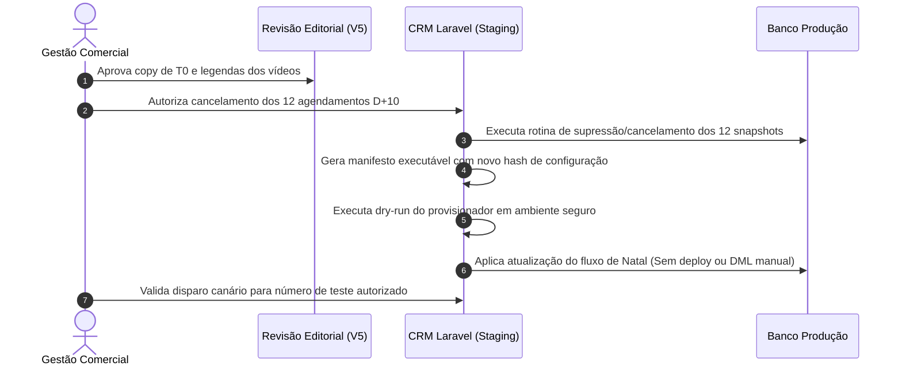

# PROXIMOS-PASSOS-GO-NOGO — Matriz Executiva de Governança e Transição de Fase

**Data:** 26/10/2026  
**Status Editorial Consolidado:** **`V5_EDITORIAL_READY_FOR_APPROVAL`**  
**Modo Operacional:** Estritamente `AUDIT_ONLY`  
**Inventário DB de Referência:** `reports/20261026-123430/inventory.json`  
**Hash de Configuração Aprovado V4:** `f64e93402d086abdfd0c678ff173ee1891cefe50f9ed3c381db0102a0ad5c055`

---

## 1. Painel Geral de Prontidão por Canal

| Canal | Etapas / Papéis | Estado Atual | Classificação | Responsável | Risco Principal |
| :--- | :---: | :---: | :---: | :---: | :--- |
| **WhatsApp (Texto/Botões)** | T0 (`initial`) | Consolidado em rascunho curto com botões contratuais V4 | ✅ **GO** | Gestão Comercial | Divergência de expectativa sobre checkout direto (resolvida em favor do catálogo V4) |
| **WhatsApp (Mídia H+1 a D+10)** | 8 Vídeos + Imagem | Legendas alinhadas frame a frame com os MP4 reais (pergaminho D+5, bolhas D+4, jogos D+3) | ✅ **GO** | Gestão Editorial | Falha de resolução do token dinâmico em D+1 (mitigada por opção de fallback estático) |
| **WhatsApp (Documento D+10)** | Mensagens `1460` / `1476` | Bloqueado (`blocked_do_not_publish`) | 🛑 **NO-GO** | Operação / Engenharia | **12 execuções pendentes congeladas no banco** prontas para disparar flyer Pix se não canceladas |
| **SMS** | 9 Etapas (`h2` a `d20`) | Preservados integralmente (`preserve_existing_v4`) | ✅ **GO** | Operação | Modificação acidental em canal de alta entregabilidade |
| **E-mail (Resend)** | T0 (Ações 24 / 34) | Preservado e-mail texto inicial (`preserve_existing_t0`) | ✅ **GO** | Operação | Alteração para HTML/PDF não homologada |
| **Telefonia (SmartVoice)** | 5 Chamadas em fila | Preservadas sem ativação (`no_activation`) | ✅ **GO** | Telecom / PABX | Ativação prematura de chamadas automáticas sem aprovação regulatória |
| **Banco / Produção CRM** | Todas as tabelas | Nenhuma alteração aplicada | 🛑 **NO-GO** | Engenharia | Execução inadvertida de `--apply`, `doctor` ou update SQL |

---

## 2. Mapa de Bloqueios Estritos (NO-GO)

> [!CAUTION]
> **1. OS 12 AGENDAMENTOS PENDENTES EM D+10 (TABELA `campaign_contact_stage_runs`)**  
> A extração factualmente confirmou que há 12 contatos com snapshots já gravados contendo o título do documento PDF D+10 (simulação de Pix). Como o worker do Laravel dispara a partir de `stage_snapshot`, **modificar o rascunho editorial ou editar a tabela `messages` não protege esses 12 leads**.  
> **Ação Necessária antes de qualquer disparo:** A equipe técnica do CRM precisará executar script administrativo de cancelamento ou higienização desses 12 registros de execução.

> [!WARNING]
> **2. INTEGRIDADE DO `configuration_hash` E RESTRIÇÃO DE PAINEL WEB**  
> O CRM calcula o `natal_runtime_configuration` a partir dos textos, canais, botões e mídias aprovados. Alterar textos soltos diretamente pelo painel administrativo do CRM pode corromper o hash e disparar erro de saúde (`PROPOSAL_FLOW_UNAVAILABLE`).  
> **Ação:** Qualquer atualização produtiva futura deve seguir o fluxo oficial de versionamento e provisionamento pelo script homologado do CRM.

---

## 3. Roteiro de Transição para Futura Aplicação (Fase 3/4)

Quando a gestão emitir a aprovação comercial expressa para os textos consolidados em `V5-COPY-REVIEW-ATUALIZADO.md`:

---

## 4. Status de Encerramento Desta Rodada

Declaramos a presente missão concluída com o veredito oficial:

### **`V5_EDITORIAL_READY_FOR_APPROVAL`**

- **Proposta Editorial:** 100% pronta, concisa, emocional e formatada para WhatsApp nativo.
- **Auditoria de Vídeos:** 100% coerente com as imagens físicas em tela e áudio.
- **Segurança Operacional:** 100% cumprida (zero mutações, zero envios, zero PII).
